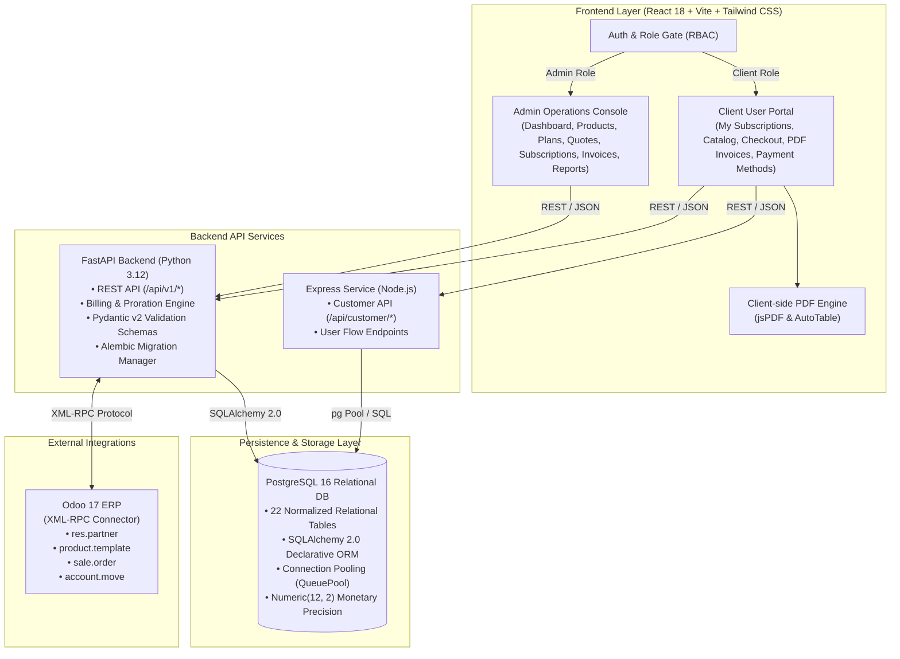

# Brightloop Software – Enterprise Subscription Management System

<div align="center">

[](https://react.dev/)
[](https://vitejs.dev/)
[](https://fastapi.tiangolo.com/)
[](https://nodejs.org/)
[](https://www.postgresql.org/)
[](https://www.sqlalchemy.org/)
[](https://www.docker.com/)
[](https://tailwindcss.com/)
[](https://pytest.org/)

**A comprehensive, dual-portal B2B recurring subscription and billing platform with quote-to-cash workflows, automated proration, pixel-perfect PDF invoicing, and Odoo 17 ERP synchronization.**

[Live Local URL](http://127.0.0.1:5173/) • [API Documentation (Swagger UI)](http://localhost:8000/api/v1/docs) • [Architecture Guide](#-system-architecture) • [Quickstart](#-quickstart-guide)

</div>

---

## 📌 Executive Summary

**Brightloop Subscription Management System** is an enterprise-grade SaaS billing, contract lifecycle, and customer self-service platform. Designed for modern multi-tier B2B and consumer subscription models, it bridges commercial quotations, recurring automated invoicing, multi-gateway payment reconciliation, and granular financial reporting into a cohesive full-stack monorepo.

The platform provides a distinct **Dual-Experience Architecture**:
1. **Admin Operations Console**: Mission control for finance teams, account executives, and system administrators to manage the complete Quote-to-Cash pipeline, monitor MRR/ARR velocity, configure catalog products, issue promotional discounts, and sync data bi-directionally with Odoo 17 ERP.
2. **Client Self-Service User Portal**: A streamlined customer hub enabling subscribers to discover service modules, purchase and upgrade plans, apply discount coupons, track real-time contract validity, manage payment methods, and download legal PDF tax invoices on demand.

---

## 🚀 Key Platform Capabilities

### 🛡️ Admin Operations Console
* **Executive Telemetry & KPI Analytics**: Real-time Monthly Recurring Revenue (MRR), Annual Recurring Revenue (ARR), Churn Rate, Average Revenue Per Account (ARPU), and collections distribution charts powered by Recharts.
* **Product Catalog & SKU Configuration**: Manage products across software tiers, billing cadences (monthly, annual, multi-year), seat limits, and add-on modules in unified Grid and Table views.
* **Subscription Plan Matrix**: Create and customize tiered billing rates, setup fees, usage limits, and trial intervals.
* **Commercial Quotation Pipeline**: Generate formal sales quotes, specify expirations and payment terms, apply client-specific discount overrides, and convert approved quotes into active recurring subscriptions in 1 click.
* **Contract Lifecycle Engine**: Track subscription statuses (`Active`, `In Grace Period`, `Suspended`, `Terminated`), automate renewal reminders, and control auto-renew triggers.
* **Billing & Invoicing Ledger**: Comprehensive invoice management with automated status tracking (`Draft`, `Open`, `Paid`, `Overdue`, `Void`).
* **Payment Settlement & Reconciliation**: Ledger tracking for credit card, wire transfer, and ACH settlement with partial-allocation math.
* **Promotional Discount Engine**: Configure fixed-amount or percentage coupon codes with max usage constraints, minimum spend conditions, and expiry dates.
* **Odoo 17 XML-RPC Synchronization**: Out-of-the-box bi-directional connectors mapping partners (`res.partner`), catalog templates (`product.template`), sales orders (`sale.order`), and accounting moves (`account.move`).

### 👤 Client Self-Service User Portal
* **Subscriber Dashboard**: Personalized contract status overview, renewal countdown timers, active licenses count, and monthly spend summaries.
* **Interactive Product Catalog**: Explore SaaS offerings, review tier benefits, compare plan pricing, and trigger seamless checkout.
* **Self-Service Checkout**: Modal checkout with real-time promo code validation, instant proration calculation, and dynamic total calculation.
* **On-Demand PDF Invoicing**: Client-side, pixel-perfect PDF invoice generator built with `jsPDF` and `jspdf-autotable`, rendering clean corporate branding, tax breakdowns, invoice numbers, and payment receipts.
* **Payment History & Stored Methods**: View historical transactions and manage billing cards and settlement details.
* **Dual Role Onboarding**: Self-service user registration with instant role selection (`Individual Subscriber` vs. `Enterprise Organization`).

---

## 🏛️ System Architecture



---

## 📁 Repository Structure

```text
Subscription_Management_System/
├── frontend/                       # Vite + React 18 + Tailwind CSS SPA
│   ├── src/
│   │   ├── components/             # Reusable atomic UI (Badges, Buttons, Cards, Modals, Tables)
│   │   ├── data/                   # Initial mock datasets and offline demo seeds
│   │   ├── pages/
│   │   │   ├── Auth/               # Dual-role Login & Signup with Predefined Roles
│   │   │   ├── Customers/          # Customer directory & company profile inspection
│   │   │   ├── Dashboard/          # Executive telemetry, MRR charts, churn analytics
│   │   │   ├── Discounts/          # Coupon campaigns and discount rule builder
│   │   │   ├── Invoices/           # Receivable invoice ledger with status badges
│   │   │   ├── Payments/           # Payment settlements, transaction tracking
│   │   │   ├── Plans/              # Multi-tier subscription package manager
│   │   │   ├── Products/           # Product Catalog with Grid & Table view modes
│   │   │   ├── Quotations/         # Proposal pipeline & quotation generation
│   │   │   ├── Reports/            # Deep financial reporting and collection breakdown
│   │   │   ├── Settings/           # Company profile, system configurations, & RBAC
│   │   │   └── UserPortal/         # Client Self-Service Hub (Catalog, Checkout, Invoices, PDF)
│   │   ├── services/               # API clients (userApi, authDatabase)
│   │   ├── utils/                  # Currency formatting, auth permissions, PDF utilities
│   │   ├── App.jsx                 # Top-level state controller & routing
│   │   └── main.jsx                # React DOM root entry
│   ├── Dockerfile                  # Multi-stage production container build (Nginx)
│   ├── package.json
│   └── vite.config.js
│
├── backend/                        # FastAPI (Python 3.12) Microservice & Odoo Connector
│   ├── alembic/                    # Database version control & migration versions
│   ├── app/
│   │   ├── api/v1/endpoints/       # 11 REST endpoint routers (Customers, Plans, Invoices, etc.)
│   │   ├── core/                   # Application settings, security, and CORS configs
│   │   ├── db/                     # SQLAlchemy Base, session factory, connection pooling
│   │   ├── modules/                # 22 Declarative SQLAlchemy 2.0 database models
│   │   └── services/               # Billing engine (MRR calculation) & Odoo XML-RPC client
│   ├── tests/                      # Pytest database & transactional test suite (8 passing tests)
│   ├── Dockerfile
│   ├── requirements.txt
│   └── pytest.ini
│
├── server/                         # Express.js (Node.js) Customer Portal API Service
│   ├── db/                         # PostgreSQL connection pool, schema, and seeds
│   ├── middleware/                 # JWT & Customer auth middleware
│   ├── routes/                     # Customer flow routes (/api/customer, /api/user)
│   ├── test/                       # Customer flow integration tests
│   └── index.js                    # Express application entry point
│
├── database/                       # Database specifications, migrations, & documentation
│   ├── docs/
│   │   ├── DATABASE_SCHEMA.md      # Column definitions, constraints, & indexes
│   │   └── ER_DIAGRAM.md           # 22-table Mermaid Entity-Relationship diagram
│   ├── scripts/                    # Database initialization & safe development reset scripts
│   └── seeds/                      # Canonical seed data for products, plans, and users
│
├── docker-compose.yml              # Monorepo container orchestration (Frontend, Backend, DB, Odoo)
├── .gitignore
└── README.md                       # Monorepo architecture & developer guide
```

---

## ⚡ Quickstart Guide

### Option 1: 1-Click Containerized Stack (Recommended)

To launch the complete platform (PostgreSQL 16, FastAPI Backend, React Frontend, and optional Odoo 17) via Docker:

```bash
# Clone the repository
git clone https://github.com/501-hashim/Subscription_Management_System.git
cd Subscription_Management_System

# Start all services
docker-compose up --build
```

Access points:
* **Frontend Web Application:** [http://localhost:5173](http://localhost:5173)
* **FastAPI Backend & Swagger UI:** [http://localhost:8000/api/v1/docs](http://localhost:8000/api/v1/docs)
* **PostgreSQL Database:** `localhost:5432` (User: `postgres`, Password: `postgrespassword`, DB: `brightloop_subscription_db`)
* **Odoo 17 ERP:** [http://localhost:8069](http://localhost:8069)

---

### Option 2: Local Developer Setup

#### 1. Database Setup (PostgreSQL 15+)
Ensure PostgreSQL is running locally or via Docker:
```bash
docker-compose up -d postgres
```

#### 2. Backend Setup (FastAPI + Python 3.12)
```bash
cd backend

# Create and activate virtual environment
python -m venv .venv

# Windows:
.venv\Scripts\activate
# Linux/macOS:
source .venv/bin/activate

# Install dependencies
pip install -r requirements.txt

# Run database migrations
alembic upgrade head

# Start API server
uvicorn app.main:app --reload --port 8000
```
Interactive docs: [http://localhost:8000/api/v1/docs](http://localhost:8000/api/v1/docs)

#### 3. Frontend Setup (React 18 + Vite)
```bash
cd frontend

# Install dependencies
npm install

# Start Vite development server
npm run dev
```
Open [http://localhost:5173](http://localhost:5173) in your browser.

#### 4. Customer Portal API Server (Optional Node.js Service)
```bash
# From repository root or frontend directory
node server/index.js
```
Server starts on [http://localhost:5000](http://localhost:5000).

---

## 👥 Predefined Testing Accounts

The system includes preconfigured demo personas accessible directly via the **Quick Sign-In Accounts** selector on the login page:

| Role / Persona | Email | Password | Access Scope |
| :--- | :--- | :--- | :--- |
| **System Administrator** | `admin@brightloop.io` | `SecurePass2025!` | Full access to Admin Operations Console, Settings, Financial Reports, & Odoo Sync |
| **Billing Specialist** | `billing@brightloop.io` | `SecurePass2025!` | Admin access focused on Invoices, Quotations, Subscriptions, and Payments |
| **Enterprise Client** | `acme@corp.com` | `SecurePass2025!` | Client User Portal: Active subscriptions, corporate billing, invoice PDF downloads |
| **Standard Subscriber** | `sarah.connor@cyberdyne.io` | `SecurePass2025!` | Client User Portal: Individual plans, catalog self-checkout, transaction receipts |

---

## 🧪 Testing & Quality Assurance

### Frontend Production Build
To verify bundling, tree shaking, and zero type or syntax errors:
```bash
cd frontend
npm run build
```
*(Transpiled via Vite with zero build errors)*

### Backend Database Integration Tests
The repository includes a comprehensive `pytest` test suite verifying database transactions, schema constraints, decimal arithmetic, and rollback handling:
```bash
cd backend
pytest tests/test_database.py -v
```

**Test Suite Coverage:**
- `test_database_connection` &check; Connection pool & ping verification
- `test_user_creation_and_role_assignment` &check; Strict foreign keys and role mapping
- `test_duplicate_email_prevention` &check; Unique constraint enforcement
- `test_foreign_key_enforcement` &check; Referential integrity checks
- `test_subscription_creation` &check; Contract lifecycle provisioning
- `test_invoice_creation_and_decimal_math` &check; High-precision currency accounting
- `test_payment_and_allocation` &check; Payment ledger distribution
- `test_transaction_rollback_recovery` &check; ACID rollback on integrity error

---

## 📊 Database Schema & 22-Table Architecture

The underlying database uses **SQLAlchemy 2.0** declarative models backed by PostgreSQL with `Numeric(12, 2)` monetary precision and UTC timestamps.

### Domain Modules
1. **Authentication & Authorization**: `users`, `roles`, `user_roles`, `email_verification_tokens`, `password_reset_tokens`
2. **Organization & Staff**: `organizations`, `organization_members`
3. **Product Catalog**: `products`, `product_variants`
4. **Subscription Plans**: `plans`, `plan_products`
5. **Quotations & Proposals**: `quotations`, `quotation_items`, `quotation_templates`
6. **Subscriptions & Contracts**: `subscriptions`, `subscription_items`
7. **Billing & Invoices**: `invoices`, `invoice_items`
8. **Payments & Allocation**: `payments`, `payment_allocations`
9. **Tax & Discounts**: `tax_rates`, `discounts`, `discount_usage`

*Detailed column-level documentation and mermaid ER diagrams are available in [`database/docs/`](file:///C:/Users/ACER/.gemini/antigravity/scratch/Subscription_Management_System/database/docs).*

---

## 🔄 Odoo 17 ERP Synchronization

Brightloop provides an asynchronous XML-RPC integration with Odoo 17:
* **Partners (`res.partner`)**: Client accounts created in Brightloop automatically synchronize customer record IDs in Odoo.
* **Catalog Items (`product.template`)**: Products and variants maintain shared SKU references.
* **Sales Orders (`sale.order`)**: Quotations generate draft `sale.order` records; activated subscriptions confirm orders and trigger contract lines.
* **Accounting Moves (`account.move`)**: Finalized invoices post directly to Odoo's general ledger for synchronized accounts receivable.

---

## 🌿 Git Branching Strategy & Workflow

* **`master`**: Main stable production branch.
* **`prototype`**: Active feature development and collaborative integration branch.
* **Feature Branches**: `feat/<feature-name>`, `fix/<bug-name>`.
* **Merge Standard**: Clean fast-forward merges or non-conflicting pull requests into `master`.

---

## 📄 License & Attribution

Developed by the **Brightloop Engineering Team** for the **Brightloop Subscription Management Initiative**.

* Lead Developer: Hashim ([@501-hashim](https://github.com/501-hashim))
* Organization: Brightloop Software Inc.
* License: MIT License.
