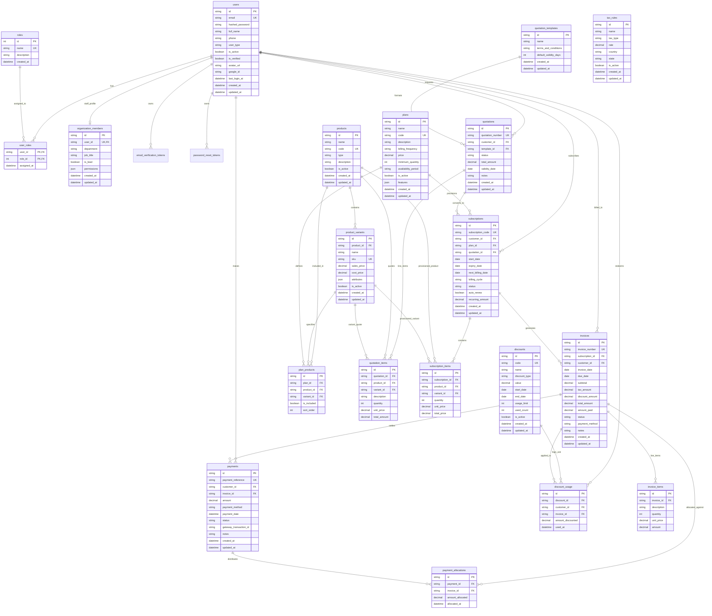

# Brightloop Subscription Management System - Entity Relationship Diagram

This diagram documents the normalized PostgreSQL relational architecture for the **Brightloop Subscription Management System**.

